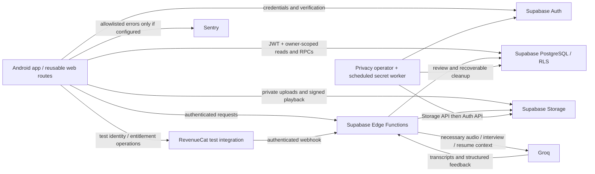

# Vocara Phase 3: privacy and account deletion

Review date: **2026-10-29, Asia/Taipei**. This is an implementation report and a
privacy-policy draft, not a legal-compliance certification. No hosted database,
real account, actual recording, Groq inference, purchase, or deployment was used
for validation. The user's later instruction authorizes committing and pushing
this work; it does not authorize deployment. Earlier Phase 2 and initial Phase 3
work was already present in the user's `ae1f2db` commit when work resumed.

## A. Executive summary

Added verified account-deletion requests, a recoverable privileged worker,
account-state gates in RLS/RPCs/Edge Functions, privacy and Terms routes, an
operator-reviewed data-copy request queue, native secure token storage, filtered
telemetry, and configurable orphan cleanup that defaults off. Existing Phase 1
reservation/recovery and Phase 2 usage/capacity code was inspected, and its tests
are included in regression validation.

The most serious confirmed authorization defect was **missing RLS and explicit
privilege revocation on `resume_generation_requests`**. Supabase-style default
table grants exposed that service ledger. Resume inserts also allowed clients to
supply server-owned extracted text and processing state. These are fixed locally.

Release still requires a real local Supabase/Storage integration run, Android
validation, processor-erasure operations, operator/contact details and legal
review. npm reported dependency advisories; compatible update attempts failed
inside npm, so those remain an explicit release risk.

## B. Security findings

| Finding | Severity | Affected files / root cause | Fix | Evidence |
| --- | --- | --- | --- | --- |
| Resume request ledger exposed under default grants | High | Migration 008 omitted RLS/revocation for `resume_generation_requests` | Migration 015 enables RLS and service-only grants | Role-based SQL tests use Supabase-style default grants and deny ledger reads |
| Resume processing state forgeable | High | Migration 008 granted unrestricted INSERT and broad metadata/state UPDATE | Explicit insert columns, only `is_active` update, immutable Storage path, existing object/path admission check | Synthetic client cannot inject extracted text or completed state; ordinary upload metadata succeeds |
| No complete deletion path or stale-token barrier | High | No durable deletion state, Storage/Auth ordering or pending-user gates | Durable job, verified identity, account-state gates, retryable Storage-first worker, Auth last | SQL tests and mocked worker recovery, including completed interview/AI-ledger cascade |
| Native tokens in ordinary storage | High | `src/lib/supabase.ts` used AsyncStorage | SecureStore adapter, chunked atomic refresh, verified plaintext migration and logout cleanup | Large Unicode session, interrupted refresh, serialized writes and logout tests |
| Private errors/context could reach logs/Sentry | Medium | Unfiltered SDK events, arbitrary error objects, global Sentry context | Strict event allowlist, no user/context/breadcrumb/error text, native Sentry disabled, RevenueCat log handler suppressed, static diagnostics | Sensitive-marker regression test; affected-file lint |
| Speaking lifecycle relied on default grants | Medium | Migration 009 omitted explicit admission/select grants and left broad INSERT when default privileges existed | Explicit safe columns; no forged status/completion; owner-scoped Storage predicates | Normal session insertion and forbidden status insertion tests |
| Storage policies depended on implicit speaking-table access | Medium / reproducibility | Storage predicates read a table without explicit SELECT grants in a fresh non-Supabase schema | Owner-scoped SECURITY DEFINER helper; explicit read grants | Non-admin upload/delete isolation tests. Hosted grants were not inspected |
| No safe orphan cleanup / unbounded abandoned uploads | Medium | Failed/ambiguous attachments could leave files; no reference-safe GC | Disabled-by-default configurable grace, transactional claims and attachment guards, private-file limits | Retention tests preserve referenced/recent files, block late attachment and recover lost removal response |
| Production RevenueCat key fallback in test-only product | Medium | Client fell back to platform production keys | Only a `test_` key is accepted; no keys or products changed | Static review; existing monetization helper tests |
| Dependency advisories remain | High release follow-up | npm audit reports 27 findings, including critical `shell-quote` and tooling/transitive highs | Reviewed; no forced Expo downgrade or unsafe lockfile edits | Both compatible npm update and audit-fix commands failed with `edgesOut` internal error |

Migration 003 already revoked interview status/question updates and protected AI
feedback. Initial review of migration 001 alone suggested otherwise; that finding
was corrected after following the complete migration chain. Migration 015 retains
defensive revocations rather than claiming a new fix for an already fixed issue.

## C. Account deletion

**User flow:** Profile -> Delete Account; the same reusable route is
`/account/delete`. The page lists affected data and limitations, asks for the
current password and literal `DELETE`, prevents repeated taps with a synchronous
lock, and distinguishes request acceptance from completed erasure. Reauthentication
uses a separate memory-only Supabase client and does not switch the app session.
The temporary verification session is signed out after the request. The page also
works for a signed-out web visitor who enters email/password.

**Identity verification:** `request-account-deletion` calls Supabase Auth
`getUser(token)` and verifies claims, checks subject equality and expiration, and
requires password/OTP/TOTP AMR within five minutes. Token refresh `iat` alone is
insufficient. Recovery-only AMR is not accepted. Client user IDs and extra body
fields are rejected. A second request returns the same durable job. Browser
origins must be explicitly allowlisted; native requests do not require Origin.
The endpoint fails closed unless the worker secret is configured.

**Sequence:**

1. Service-only RPC derives the job from the verified identity. One unique job per
   user; a per-user transaction lock serializes admission with new writes.
2. RLS hides sensitive rows, user RPCs deny access, Edge Functions check account
   state before privileged work, and write triggers reject in-flight completions.
   The app routes pending accounts to the deletion page and stops RevenueCat login.
3. A ten-minute drain window precedes cleanup (longer than the existing eight-minute
   AI lease). The operator reviews external processors and confirms that step using
   `confirm_account_processor_erasure(job_id)`. This is mandatory, not automatic.
4. The secret-authenticated worker claims one due job with `FOR UPDATE SKIP LOCKED`
   and a five-minute fenced lease. It lists owned objects from the three private
   buckets, including unreferenced uploads, and removes them through the Storage API.
   Each request is bounded; up to five 100-object batches are handled per invocation.
5. After a fresh lease-checked empty Storage listing, Auth admin deletion removes
   the account; existing profile FKs cascade application content and usage. FK
   `SET NULL` updates during the cascade are allowed once the profile is gone, while
   ordinary writes to a pending account remain blocked.
6. Completion clears the job's user ID and lease. Only random job ID, timestamps,
   attempt count, review flag and status remain. No interview content or email is
   copied into the job. Completed metadata currently has no automatic purge period.

A failed Storage/Auth call records a controlled error and makes the same job due
again after 15 minutes. A crashed worker's lease expires; another invocation can
resume. Missing Auth users are treated idempotently on retry. A completion RPC
refuses to claim success while Auth still exists. No SQL deletion of Storage
metadata is used in the real worker (only synthetic fixture tests simulate it).

**Session limits:** pending/deleted accounts are denied even if a signed JWT has
not expired. Bootstrap checks Auth server validity. Auth deletion invalidates the
account and refresh lifecycle, but already issued JWTs and signed Storage URLs
are not magically erased from devices. Previously downloaded data and browser
caches cannot be revoked. Existing signed URLs may remain usable until expiry or
object removal; client-generated playback links default to 60 seconds / 300 seconds
and are capped at 300 seconds in the client helper. That helper is not a server-wide
maximum for the Supabase signing API.

**External processors:** no RevenueCat customer was deleted. The operator must
review identity aliases, any restored/test purchases and provider erasure before
confirming the job. Automatically deleting a shared RevenueCat alias could affect
another account. Account deletion is not store-subscription cancellation. Review
historical Sentry events and Groq retention/settings as applicable; do not promise
instant removal from their backups. No legal-retention obligation was invented.

**Page status:** reusable Expo route implemented, not deployed or submitted to
Google Play. A working public HTTPS page and allowlisted origin must be configured
before store submission. Final completion is visible to the operator in the job
queue; the app shows accepted/pending state rather than falsely claiming immediate
completion. No automated completion email or public receipt lookup was added.

## D. Data inventory and flow

| Data / purpose / source | Actual storage and recipients | Access | Retention and deletion |
| --- | --- | --- | --- |
| Email, credential/session records; sign-in and recovery | Supabase Auth; native session in SecureStore, web sessionStorage | Auth user and privileged Auth administration | Auth deleted last; native logout clears tokens; Auth logs/backups follow unverified provider settings |
| Name, avatar URL, career role, experience, focus and preferences | `profiles`, `user_focus_areas`, `user_preferences`; app inputs | Owner RLS and service role | Profile FK cascades on Auth deletion; no automatic age purge |
| Interview settings, sessions and generated/local questions | `interview_sessions`, `interview_questions`; app/question bank or Groq | Owner RLS, controlled RPCs | Cascades with owner; referenced history preserved |
| Recordings and upload metadata | Private `interview-audio`, `speaking-audio`; app cache; answer/attempt audio fields | Owner paths/RLS and service role; temporary signed playback URLs | Normal local discard/unmount cleanup; server cleanup at account deletion; optional old orphan cleanup only |
| Transcripts and speech metrics | `interview_answers`, `speaking_attempts`; Groq transcription | Owner RLS/RPC and service role | Cascades with parent; not copied to telemetry |
| Answer/session/speaking feedback and generated coaching | `answer_feedback`, `interview_session_feedback`, `speaking_feedback`; Groq plus deterministic scores | Owner read, server write | Cascades; saved results reused rather than cross-user prompt cache |
| Speaking prompts/history/practice statistics | `speaking_sessions`, `user_practice_days`; user activity | Owner RLS/RPC | Cascades; no unrelated analytics store found |
| Job descriptions, parsed requirements, generation claims | `job_descriptions`, `job_analyses`, `job_generation_requests`; user/Groq | Owner reads where granted; service-only claims | Cascades with profile; no age purge |
| PDF resumes, extracted text, analysis and comparisons | Private `resumes` bucket; `resumes`, `resume_analyses`, `resume_job_matches`, `resume_generation_requests`, `resume_match_requests` | Owner file/content reads; server analysis/ledger writes | Resume deletion removes record then attempts Storage removal; account cleanup catches leftovers; local picker copy cleaned in finally |
| Subscription IDs, entitlement state and test linkage | `user_subscriptions`; RevenueCat SDK/API | Owner read, server-controlled writes | Local mapping cascades; processor alias erasure is reviewed separately |
| Allowance, reservations and request accounting | `feature_usage`, `feature_usage_events`, `interview_reservations`, `transcription_requests`, `ai_evaluation_requests`, speaking request ledgers, `ai_usage_attempts` | Owner usage summaries, service-only detailed ledgers | Cascades; AI usage is metadata/tokens/duration, not prompt text |
| Shared price/limit configuration | `plan_feature_limits`, `ai_capacity_settings`, `ai_model_rates`, `private_file_retention_settings` | Administrative | Not personal content; preserved on account deletion |
| Webhook deduplication | `revenuecat_webhook_events`: event ID and timestamps, no account FK/body | Service-only | Retained for deduplication; no configured purge period |
| Deletion and access requests | `account_deletion_jobs`, `account_data_requests` | Service-only; own status/request RPC | Account ID cleared after deletion job completes; data-copy queue cascades |
| Orphan deletion claims | `private_file_cleanup_claims`: bucket/path/account metadata | Service-only | Removed after confirmed Storage deletion, or profile cascade |
| Error monitoring | Sentry only when DSN is configured; server/client diagnostic logs | Provider/project administrators | New JS events allowlisted; native capture disabled; historical retention settings not inspected |

No other analytics integration was identified. Avatar URLs are stored references;
no avatar upload bucket was invented. Backups, hosting region, support exports and
provider administrative logs are operational settings requiring owner review.

## E. Authorization and file review

All application tables now enable RLS. Existing owner policies remain, supplemented
by restrictive current-account checks. All pre-existing authenticated SECURITY
DEFINER user RPCs receive an active-account guard while preserving their signatures
and existing ownership checks; anonymous execution is revoked. The migration fails
if its guard-insertion process encounters an unexpected function language. New
helper functions either derive `auth.uid()` or are service-only. Search paths are
fixed. Anonymous/user roles have no TRUNCATE/REFERENCES/TRIGGER rights on app tables.

AI claim/completion RPCs remain service-only. The ten AI endpoints retain authenticated
middleware and existing payload/ownership checks, and now check account state.
`sync-subscription` also checks state. The signed RevenueCat webhook ignores deleted
or pending identities and never recreates their entitlements. The new deletion
endpoint validates Auth and recent AMR itself; the worker uses a separate server-only
secret, never a user-supplied account ID. Both new endpoints intentionally configure
`verify_jwt=false` because their explicit authentication differs; do not remove it.

Usage cost views retain `security_invoker=true` and administrative-only grants.
Owner data-copy requests are deduplicated, bounded to one new request/day, and queued
for manual verified delivery; no insecure downloadable export was introduced.

Private buckets, owner prefixes and immutable audio paths remain. Existing server
AAC/M4A parsing validates content/duration, and resume processing parses actual PDF
bytes with size/page/text/time limits; MIME/extension alone is not relied on for AI
processing. Per-file caps remain 5 MiB, audio at most 120 seconds. Resumes are capped
at 20 stored files per account; interview recording paths at ten retained uploads
per answer (not a cap on completed interview history). Speaking uses immutable
attempt paths and existing server attempt reservations. Resume object overwrites
are denied; old analysis cannot silently refer to replaced bytes.

Resume prompts omit email-like contact strings and international phone patterns
before Groq transfer. This is minimization, not anonymization: names, employers,
portfolio links, work history and user-spoken personal information may remain
where supplied. No email/name/auth credential from the profile is added to AI
prompts; selected career/focus and relevant job/resume context are used. Existing
cache reuse is owner/resource-scoped database state, not a global cross-user cache.

Orphan cleanup defaults **disabled**, with a seven-day grace adjustable between
24 hours and one year. An administrative dry run creates no deletion claims.
Enabled cleanup serializes against attachment/upload writes, rechecks references,
then places a tombstone that blocks a late attachment before Storage removal.
Referenced content of any age and recent uploads are preserved. No historical
playback or feedback is intentionally removed by this mechanism.

## F. Privacy documentation and official guidance

- In-app draft: `src/app/privacy.tsx`; draft Terms: `src/app/terms.tsx`.
- Deletion instructions and verified route: `src/app/account/delete.tsx`.
- Operational instructions: `docs/PRIVACY_OPERATIONS.md`.
- Configuration placeholders: `docs/PRIVACY_CONFIGURATION.example.env`.
- Inventory, diagram and processor limits: this report.

The user does not yet know the operator name/privacy contact. Marked placeholders
remain, as requested. Resolve those, effective date, lawful bases, age eligibility,
hosting/international-transfer details, actual backup/provider retention, request
turnaround and any transaction/fraud/legal holds before publication. A legal reviewer
should assess applicable Philippine requirements; engineering tests do not establish
legal compliance.

[Google Play](https://support.google.com/googleplay/android-developer/answer/13327111)
requires an in-app deletion path and an external web resource for apps offering
account creation. This code prepares both paths but does not supply a deployed URL.

[Groq's data documentation](https://console.groq.com/docs/your-data) describes possible
inference retention for reliability/abuse monitoring up to 30 days and configurable
controls. The project's settings and contractual exceptions were not inspected;
this report does not claim zero retention or instantaneous provider erasure.

[Supabase user management](https://supabase.com/docs/guides/auth/managing-user-data)
documents Storage cleanup and JWT-expiry considerations around Auth deletion.
[JWT claims](https://supabase.com/docs/guides/auth/jwt-fields) describe AMR used for
recent-authentication verification. [Expo SecureStore](https://docs.expo.dev/versions/latest/sdk/securestore/)
provides the native storage mechanism; a rebuilt development client is required.

The [Philippine NPC rights guidance](https://privacy.gov.ph/data-subject-rights/)
covers information, access, correction, objection, erasure/blocking and portability,
subject to applicable conditions. The [Data Privacy Act](https://privacy.gov.ph/data-privacy-act-/)
requires legal/operational review beyond this implementation.

[RevenueCat customer documentation](https://www.revenuecat.com/docs/api-v1/customers)
provides customer-deletion APIs. This worker deliberately requires reviewed external
erasure rather than automatically deleting potentially shared alias identities.

## G. Validation

- **104 SQL assertions passed** across all 16 migrations: 20 interview reliability/cascade, 30 AI accounting, 45 privacy/authorization, 9 retention.
- **61 Deno backend tests passed**, including 9 new privacy/auth/deletion/minimization cases; network denied and provider calls mocked.
- **51 client tests passed**, including 4 secure-storage, 1 telemetry and 3 deletion-service regressions.
- **3 offline cost tests passed**. The real HTTP integration suite was invoked but **all 3 tests skipped** because local credentials/infrastructure are not configured; this is not a passing integration claim.
- Client TypeScript, all 14 Edge Function entrypoints with frozen dependencies, affected-file ESLint, and diff whitespace checks passed.
- npm security update attempts **failed** with an internal `Cannot read properties of null (reading edgesOut)` error; no dependency remediation is claimed.
The SQL runner uses real PostgreSQL/pgTAP compiled to WASM, realistic authenticated/
anonymous roles and Supabase-style default table grants, with minimal Auth/Storage
fixtures. It does not simulate real Storage signed-URL verification, Auth issuance,
multiple concurrent database connections, or a physical device.

Prepared HTTP coverage: `scripts/test_privacy_http.py` refuses all non-loopback
URLs and uses only synthetic accounts. It covers Storage ownership, expired signed
URLs, invalid Edge credentials and duplicate deletion/pending access. It is not
executed against a hosted project. Real Docker/psql tests and Android checks remain
release gates.

## H. Database, deployment and rollback

Review migrations **015** (account privacy/deletion/permissions) and **016** (orphan
retention) together with all changed functions. This task did not apply them remotely.
Migration 015 was already committed locally in partial form by the user before
continuation; its final contents must be reviewed. If any earlier variant was applied
elsewhere despite the no-deploy scope, create a forward migration instead of relying
on a modified applied migration.

New endpoints: `request-account-deletion`, `process-account-deletions`. All existing
AI functions, `sync-subscription`, and `revenuecat-webhook` also change. Native build
adds Expo-compatible `expo-secure-store` and its plugin. The Deno lock records the
pinned direct Supabase client import. See the operations document for configuration,
scheduling, manual review, validation, monitoring and coordinated rollout.

Do not roll back by reopening permissions or deleting pending jobs. Disable the
worker schedule/secret first if needed, keep pending-account gates, inspect job state,
and apply a reviewed forward fix. An actually erased account cannot be restored by
a code rollback. Backups are subject to policy and must not silently resurrect a
pending/deleted account. No destructive rollback is executed here.

## I. Remaining risks (priority order)

1. **High before release:** dependency advisories remain; npm's compatible update
   commands failed internally. Resolve in a clean dependency-maintenance environment
   and rerun builds/tests; do not accept npm's proposed Expo 51 downgrade as a fix.
2. **High before release:** run real local Supabase Auth/Storage/parallel tests, exercise
   scheduled retries, review leases and processor steps, and verify all migrations.
   Configure an operator and worker schedule; queued requests cannot complete without
   external review. Confirm uploaded files in any future bucket are added to cleanup.
3. **High before publication:** fill operator/contact placeholders and approve legal,
   processor, retention and Data Safety disclosures. Deploy the public HTTPS deletion
   page personally and verify it independently of an installed app.
4. **Medium:** perform physical Android SecureStore migration/logout, force-close,
   microphone/background, weak-network, recording recovery and PDF-cache cleanup tests.
   Native Sentry capture is intentionally disabled until privacy filtering is verified.
5. **Medium:** previously issued signed URLs, cached downloads, old telemetry and
   provider/backups require operational handling. A provider request dispatched before
   deletion may still finish externally; application persistence is blocked. No guarantee
   of exactly-once external inference or instant global erasure is made.
6. **Medium:** web uses sessionStorage, which remains accessible to page JavaScript;
   a future web deployment needs CSP/XSS protection and a separate auth/storage review.
   Password-based reauthentication matches the current app; future OAuth-only/MFA
   account flows need their own verified UI.
7. **Operational:** review metadata retention periods and secure manual data-copy
   delivery. No public export, legal hold engine, or automated deletion email was added.

## J. Commit message

`feat(privacy): add verified account deletion and data protection`

## Changed-file inventory for this continuation

- `app.json`
- `docs/PHASE_3_PRIVACY_REPORT.md`
- `docs/PRIVACY_CONFIGURATION.example.env`
- `docs/PRIVACY_OPERATIONS.md`
- `scripts/test_privacy_http.py`
- `src/app/(tabs)/profile.tsx`
- `src/app/(tabs)/resume.tsx`
- `src/app/_layout.tsx`
- `src/app/account/delete.tsx`
- `src/app/privacy.tsx`
- `src/app/terms.tsx`
- `src/lib/authErrors.ts`
- `src/lib/authStorage.ts`
- `src/lib/authStorageAdapter.test.ts`
- `src/lib/authStorageAdapter.ts`
- `src/lib/privacyTelemetry.test.ts`
- `src/lib/privacyTelemetry.ts`
- `src/lib/sentry.ts`
- `src/lib/supabase.ts`
- `src/providers/AuthProvider.tsx`
- `src/providers/SubscriptionProvider.tsx`
- `src/services/accountDeletionService.test.ts`
- `src/services/accountDeletionService.ts`
- `src/services/audioService.ts`
- `src/services/authService.ts`
- `src/services/profileService.ts`
- `src/services/resumeService.ts`
- `src/services/revenueCatService.ts`
- `src/types/database.ts`
- `supabase/config.toml`
- `supabase/functions/_shared/accountPrivacy.ts`
- `supabase/functions/_shared/deletionHttp.ts`
- `supabase/functions/_shared/resumePrompts.ts`
- `supabase/functions/analyze-job/index.ts`
- `supabase/functions/compare-resume-job/index.ts`
- `supabase/functions/deno.lock`
- `supabase/functions/evaluate-answer/index.ts`
- `supabase/functions/evaluate-speaking/index.ts`
- `supabase/functions/finalize-interview/index.ts`
- `supabase/functions/generate-job-interview/index.ts`
- `supabase/functions/generate-personalized-interview/index.ts`
- `supabase/functions/process-account-deletions/index.ts`
- `supabase/functions/process-resume/index.ts`
- `supabase/functions/request-account-deletion/index.ts`
- `supabase/functions/revenuecat-webhook/index.ts`
- `supabase/functions/sync-subscription/index.ts`
- `supabase/functions/tests/accountPrivacy_test.ts`
- `supabase/functions/tests/databaseSmoke.ts`
- `supabase/functions/transcribe-answer/index.ts`
- `supabase/functions/transcribe-speaking/index.ts`
- `supabase/migrations/015_privacy_and_account_deletion.sql`
- `supabase/migrations/016_private_file_retention.sql`
- `supabase/tests/database/interview_reliability.test.sql`
- `supabase/tests/database/privacy.test.sql`
- `supabase/tests/database/retention.test.sql`
